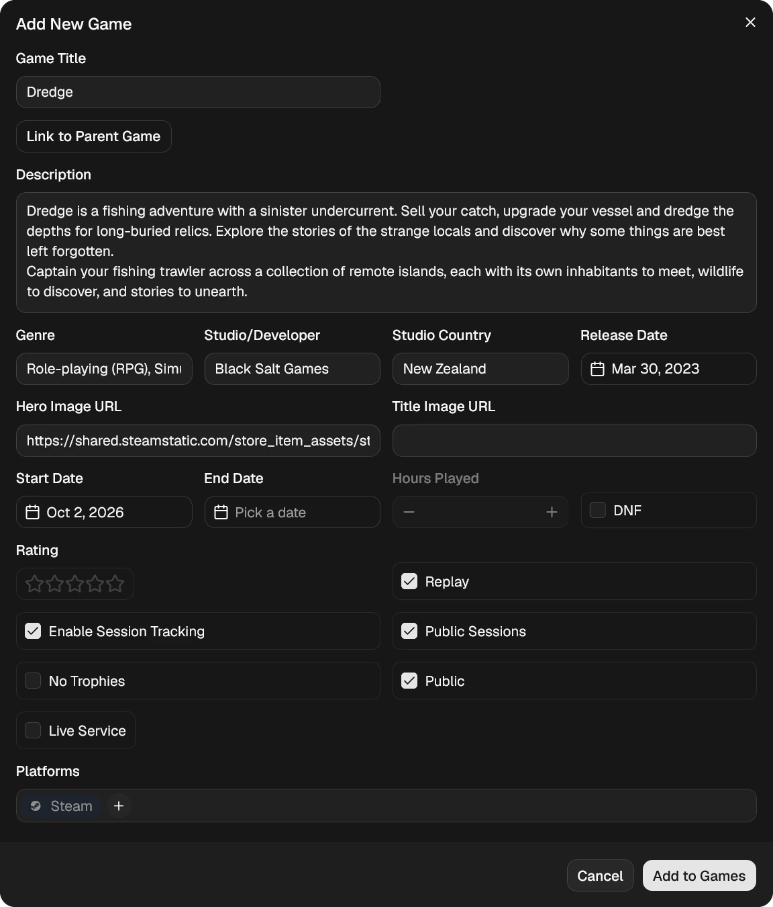

# Adding Games

Most games are added from **Search**. It's called **Add New** in the navbar and bottom bar, and **Add New / Browse** in the phone menu.

On a computer you can also search from any page: click the magnifying glass in the navbar to open a search box. Results drop down under it: click one to open its [game page](/social/game-pages), use **+** or the clock button to add it to your Games or [Up Next](/library/up-next), or press Enter (or click **See all results**) to open the full results on the Search page.

If you've played a lot on Steam, PlayStation or Xbox, importing your history is quicker than adding games one at a time. See [Getting Started](/getting-started) for how to link a platform and import.

## Searching

Before you type anything, the page shows rows of game covers:

- **Recommended for You**: games like the ones you've rated highly or played a lot, especially recently, that aren't in your library or Up Next.
- **What People You Follow Are Playing**: games people you follow have played in the last two weeks that aren't in your library yet. Their avatars show in the top-left corner of each cover. Only games and sessions they've made public count.
- **Popular Right Now**: the most popular games released in the last three months, based on what IGDB users are viewing, playing and want to play.
- **Coming Soon**: the most anticipated games due out in the next four months, in release order. **Add to Up Next** on one to keep track of it until it's out.

If one of your own rows has nothing in it yet, for example because you haven't rated or played any games, it moves to the bottom of the page.

Swipe a row on a phone, or use its arrows on a computer. Start typing to swap the rows for your search results, and clear the search box to bring them back.

Type all or part of a game's title. Results come from FrogLog's own game index, which is built from IGDB, so they include console, PC and older games.

If you know a game's Steam app id, you can search for it directly, for example `appid:524220`.

Search results and the rows above both show games as covers. Click a cover to open the game's [game page](/social/game-pages), with its details, who on FrogLog has played it, reviews, screenshots and more.

Hover over a cover for two buttons in its top corner. On a phone they're always there.

- **+**, which opens the **Add New Game** form. It shows a tick once you've added the game.
- A clock button, which adds the game to your [Up Next](/library/up-next) list in one click. It shows a tick if the game is already there.

> **[Screenshot]** Search results as cover tiles, with one cover highlighted and its + and Up Next buttons showing.

Going back to Search from a game page shows the same results, scrolled to where you were.

If a search finds nothing, try a shorter title, or add the game yourself with **Add Custom Game (Mod/Fork)** (see below).

## The Add New Game form

Most fields are already filled in from the game's database entry. Change anything you like before saving.

### About the game

| Field | What it's for |
|---|---|
| **Game Title** | The name shown everywhere in FrogLog |
| **Link to Parent Game** | Marks this as a mod or fork of another game. See "Custom games, mods and forks" below. |
| **Description** | The game's summary |
| **Genre**, **Studio/Developer**, **Studio Country**, **Release Date** | Used for filtering and in your stats |
| **Hero Image URL** | The large artwork at the top of the details card |
| **Title Image URL** | The game's logo. When the details card's artwork is expanded, the logo is shown over it in place of the game's name. Only used when **Show Steam Title Image** is on, in **Profile > Settings > Display & Layout**. |

### Your playthrough

| Field | What it's for |
|---|---|
| **Start Date** | When you started. Setting this makes the game In Progress. |
| **End Date** | When you finished. Setting this makes the game Completed. |
| **Hours Played** | How long you played |
| **DNF** | Tick if you stopped without finishing. See [Replays and DNF](/library/replays-and-dnf). |
| **Rating** | One to five stars, in half-star steps |
| **Replay** | Tick if you've played this game before. See [Replays and DNF](/library/replays-and-dnf). |

Leave both dates empty for a game you own but haven't started.

### Options

| Option | What it does |
|---|---|
| **Enable Session Tracking** | Hours come from individual play sessions instead of one total. See [Sessions](/library/sessions). |
| **Public Sessions** | Lets other users see this game's sessions. Needs session tracking (or Live Service) and **Public**. |
| **No Trophies** | Hides the Trophies button for this game |
| **Public** | Lets other users see this game. Untick to keep it private. |
| **Live Service** | Adds it as a [live service game](/library/live-service-games) instead |

### Platforms

You must pick at least one platform before you can save. If the game is on Steam, a Steam chip is offered. Click it to confirm you're playing on Steam, or remove it if you're not.

For anything else, type the platform into the box, for example `PS5`, `Epic Games` or `Xbox (Game Pass)`, and press Enter. You can add more than one.

If you try to save without a platform, the platform box shakes to show it's needed.

### Saving

Click **Add to Games** (or **Add to Live Service**).

## Adding a game you already have

If FrogLog spots that the game is already in your library and you haven't finished it yet, it asks before adding anything:

- **Attach To Existing Entry** adds this platform to the game you already have. No new entry is created.
- **Log Separately** creates a new entry, recorded as a replay of the original.

You'll see the same choice if you already track the game through this exact platform, for example the same Steam game.

## Custom games, mods and forks

If a game isn't in search, or you're playing a mod, fan game or fork of something else:

1. On the Search page, click **Add Custom Game (Mod/Fork)**.
2. Search for the game it's based on and pick it. The new entry starts with that game's details and is marked as a child of it. Or click **Skip** to start with a blank form.
3. Fill in the form and save.

Custom games show a fork icon in your library. To unlink a game from its parent, open its edit form and untick **Child of ...**.
