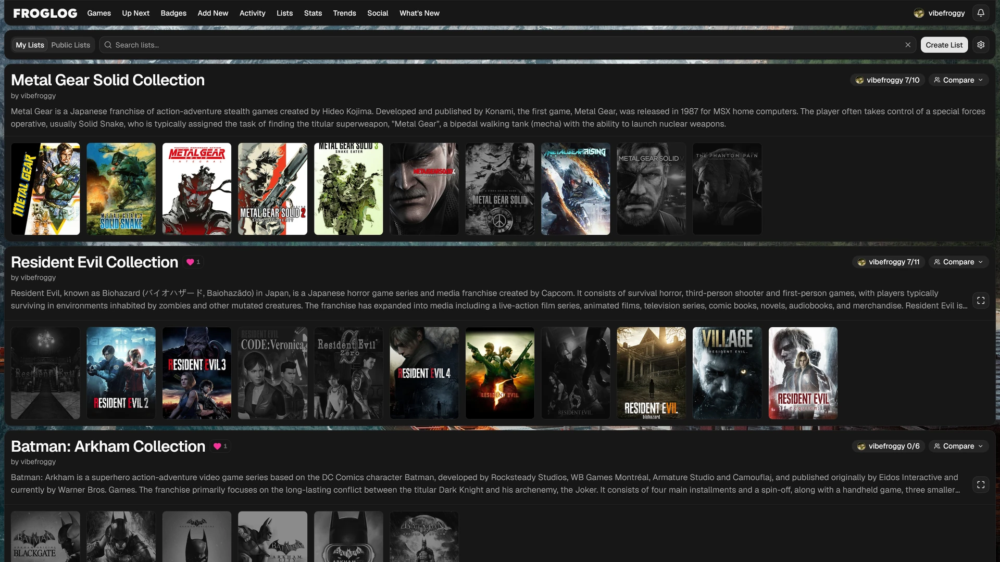

# Lists

**Lists** are collections of games you put together yourself, such as a franchise, a genre you love, or your all-time favourites. A list can include games you haven't played.

Open **Lists** from the navigation. It has two tabs:

- **My Lists**: lists you've made.
- **Public Lists**: lists other users have shared.

Each list is a card with its first five covers, its name and how many games it has (and, on other people's lists, who made it). Use the search box to find a list by name (on **Public Lists**, also by who made it), and click a card to open the list.

To change the order of your lists, click **Reorder**, drag the cards, then click **Done**.

## A list's page

Every list has its own page. At the top are its name, who made it and when it was last updated (when a game was last added), then its description and a few figures:

| Figure | What it is |
|---|---|
| **Games** | How many games are on the list |
| **You've Played** | On someone else's list, how many of its games you've played |
| **Played** | How many the creator has played |
| **Released** | The years the games came out, earliest to latest |
| **Time to Beat via HLTB** | Roughly how long the whole list takes to play through: every game's main-story time from HowLongToBeat, added up, with the average per game underneath (**per game avg**). Games FrogLog hasn't fetched a time for yet are looked up while you're on the page (it shows **looking up N more…** until they're in). Games HowLongToBeat doesn't know aren't counted. Hidden if you've turned HowLongToBeat off in your settings. |
| **Most Played** | The list's game that the most people on FrogLog have, and how many |

> **[Screenshot]** A list's page: the header card with the cover strip, name, creator, description and figures, and the cover grid below it.

Below them are the list's games as a grid of covers, with the same search, sort and cover size slider as your Games' grid view. Sort by **List order** (the creator's order), **Title**, **Release date** or **Date added**.

On someone else's list, click the heart to like it. On a phone, **Back** at the top goes back to where you came from.

## Creating a list

1. On the **My Lists** tab, click **Create List**.
2. Enter a **Name**, for example "Kingdom Hearts Collection", and an optional **Description**.
3. Optionally add a hero image and title image (see **Hero and title images** below).
4. Click **Create**. The new list's page opens, ready for you to add games.

## Importing a list

To bring in a list from a spreadsheet or another site, click the import button next to **Create List**.

1. Paste one title per line, or click **Choose File** to pick a CSV or text file. FrogLog finds the title column (one headed Title, Name or Game) and a year column if there is one. If it picks the wrong columns, change **Title Column** and **Year Column**. A year helps it tell an original from its remake.
2. Click **Find Matches**. FrogLog matches each title to a game. Titles it matched exactly need no attention; the rest are marked **Check** or **No Match**, and **To Check** shows just those. Use the menu under each title to pick a different game, add the title as a custom game (just the name, for games FrogLog doesn't know, as with **Add Game**'s custom entry), or **Skip** to leave it out.
3. Choose **New List** (with a name, optional description and whether it's public) or **Add to a List** to add the games to one of your lists.
4. Click **Import**. Games already on the list are skipped, and games you already have are linked to your copy. The list's page then opens.

You can import up to 300 titles at a time.

## Editing a list

Open one of your lists. Its page has these buttons under the name:

| Button | What it does |
|---|---|
| **Add Game** | Search for a game to add. Games already in your library are labelled **In your library**. |
| **Edit Details** | Change the list's name, description, hero image and title image (see below) |
| **Public** / **Private** | Share the list on the Public Lists tab, or keep it to yourself. Private lists show a padlock. |
| **Delete** | Delete the list (click again to confirm) |

Above the covers:

- **Reorder** lets you drag games into a new order. Click **Done** when you're finished.
- **Edit Games** (the gear) puts two buttons on each cover: change the game's title or cover image just for this list, or remove it from the list. Click **Done** when you're finished.

### Hero and title images

A list can have its own artwork, set when you create it or with **Edit Details**:

- **Hero Image URL**: a wide image for the banner across the top of the list's page. Without one, the banner blends the list's first covers together.
- **Title Image URL**: a logo shown in place of the list's name. Logos come in all shapes, so use **Title Image Size** to make it smaller or larger (50% to 200%). Click the percentage to go back to 100%.

Paste an image link, or click the SteamGridDB button beside either field to choose from SteamGridDB's artwork. It starts with the list's first game: pick another from **From this list**, or search for any game, for example the series a list is about.

The **Preview** below shows the banner exactly as it looks on a computer. The banner is wider than most hero images, so only part of the hero shows: drag the preview to choose which part, and click **Centre Hero** to put it back in the middle. On a phone the banner is narrower, so it shows less of the hero's sides instead.

## What you've played

Covers are greyed out for games you haven't played. To see every cover in colour, turn off **Show Logged** above the covers; FrogLog remembers your choice on that device.

Click a game to open its [game page](/social/game-pages). Hover over a game you don't have (on a phone, look in its top corner) for **+** to add it to your Games and the clock button to add it to [Up Next](/library/up-next).

If a game in someone else's list doesn't count as played even though you have it, FrogLog hasn't matched it to your library, usually because the titles differ. Hover over its cover, click the wand button (**Fix Match**) and pick the right game from your library. To undo a manual match, click the **X** in the same place.
