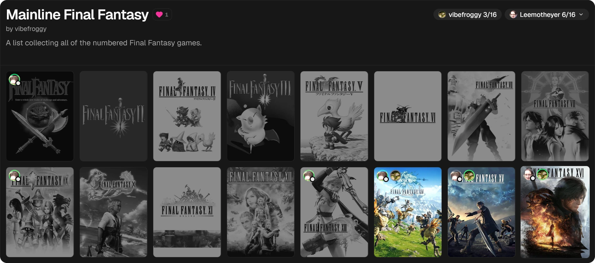

# Lists

**Lists** are collections of games you put together yourself, such as a franchise, a genre you love, or your all-time favourites. A list can include games you haven't played. Each list shows how many of its games you've played.

Open **Lists** from the navigation. It has two tabs:

- **My Lists**: lists you've made.
- **Public Lists**: lists other users have shared.

Use **Search lists...** to find a list by name.

## Creating a list

1. On the **My Lists** tab, click **Create List**.
2. Enter a **Name**, for example "Kingdom Hearts Collection", and an optional **Description**.
3. Click **Create**.

## Importing a list

To bring in a list from a spreadsheet or another site, click the import button next to **Create List**.

1. Paste one title per line, or click **Choose File** to pick a CSV or text file. FrogLog finds the title column (one headed Title, Name or Game) and a year column if there is one. If it picks the wrong columns, change **Title Column** and **Year Column**. A year helps it tell an original from its remake.
2. Click **Find Matches**. FrogLog matches each title to a game. Titles it matched exactly need no attention; the rest are marked **Check** or **No Match**, and **To Check** shows just those. Use the menu under each title to pick a different game, add the title as a custom game (just the name, for games FrogLog doesn't know, as with **Add Game**'s custom entry), or **Skip** to leave it out.
3. Choose **New List** (with a name, optional description and whether it's public) or **Add to a List** to add the games to one of your lists.
4. Click **Import**. Games already on the list are skipped, and games you already have are linked to your copy.

You can import up to 300 titles at a time.

## Editing lists

Click the gear button (**Edit lists**) in the toolbar to turn on editing. Each of your lists then shows:

| Button | What it does |
|---|---|
| **Add Game** | Search for a game to add. Games already in your library are labelled **In your library**. |
| **Edit Title** | Change the list's name and description |
| **Public** / **Private** | Share the list on the Public Lists tab, or keep it to yourself. Private lists show a padlock. |
| **Delete** | Delete the list (click again to confirm) |
| Arrow buttons | Move the list to the top, up, down or to the bottom of your lists |

While editing, you can also:

- Drag games to reorder them within a list.
- Remove a game from the list.
- Change a game's title or cover image, just for this list.

Click the gear again when you're done.

## What you've played

Each list shows three rows of covers. A longer list ends its third row with **Show More** (and how many more there are): click it to see the rest, and **Show Less** at the end to fold it up again. While editing, every game is shown.

Covers are dimmed for games you haven't played, and show your avatar on the ones you have. The badge next to the list's name shows your played count.

Click a game you have to open it in your Games (hover over it for a button to its [game page](/social/game-pages)), or any other game to open its game page. Hover over a game you don't have (on a phone, look in its top corner) for **+** to add it to your Games and the clock button to add it to [Up Next](/library/up-next).

If a game in someone else's list doesn't count as played even though you have it, FrogLog hasn't matched it to your library, usually because the titles differ. Hover over its cover, click the wand button (**Fix Match**) and pick the right game from your library. To undo a manual match, click the **X** in the same place.

## Comparing with someone else

Use **Compare against** on a list to pick someone you follow. Their avatar then appears on the games they've played, with their played count next to yours. Pick **No comparison** to switch it off.

You can only compare against people you follow. Follow people from the **Social** page.

